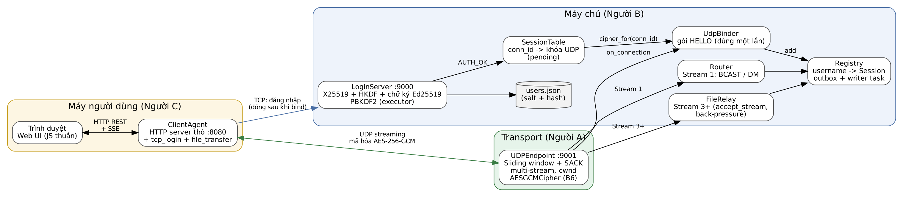

# B11 – Kiến trúc tầng máy chủ và mô hình bảo mật

## 1. Thành phần (thư mục `server/`)

| Module | Việc | Plan |
|---|---|---|
| `main.py` | Điểm vào, ghép các thành phần, tác vụ nền bền vững, tắt sạch khi Ctrl+C | B1, B9 |
| `tcp_server.py` | TCP 9000: KEY_EXCHANGE (client gửi trước, server ký transcript) → REGISTER/LOGIN → AUTH_OK → chờ gói HELLO → đóng | B2, B3, B4 |
| `auth.py` | PBKDF2-HMAC-SHA256, 100 000 vòng, muối 16 B, chạy trong executor; ghi `users.json` nguyên tử | B3 |
| `udp_bind.py` | `SessionTable` (conn_id chờ gói HELLO, dùng một lần, hết hạn 10 s) và `UdpBinder` | B4 |
| `registry.py` | Bảng người online, outbox riêng cho từng client, quét im lặng > 15 s, báo `SESSION_REPLACED` | B5 |
| `router.py` | Stream 1: broadcast, DM, chuyển FILE_* cho relay; Stream 2: nhận và trả lời heartbeat | B7 |
| `file_relay.py` | Stream 3+: nhận stream chunk mới, nhận diện phiên bằng `transfer_id`, bơm có back-pressure, giữ FILE_DONE đến khi đủ byte | B8 |

`shared/crypto.py` (X25519, HKDF 4 khóa, kênh TCP mã hóa, chữ ký Ed25519 trên transcript), `transport/cipher.py` (AES-256-GCM cho tầng A), `shared/messages.py` (G2), `shared/config.py` (G4).

## 2. Luồng đăng nhập

Chi tiết từng thông điệp và lý do: [protocol_messages.md](protocol_messages.md). Sơ đồ trạng thái: [diagrams/h1_login.png](diagrams/h1_login.png).

1. Client gửi khóa công khai X25519 tạm thời (rõ). Server trả khóa của mình kèm chữ ký Ed25519 lên transcript (nhãn + khóa client + khóa server + khóa danh tính). Client kiểm bằng khóa danh tính đã ghim; sai thì dừng.
2. Hai bên tính bí mật chung, HKDF-SHA256 (salt = SHA-256 của hai khóa công khai) ra 4 khóa: `tcp_c2s`, `tcp_s2c`, `udp_c2s`, `udp_s2c`.
3. REGISTER/LOGIN đi trên kênh TCP đã mã hóa. LOGIN đúng → server cấp `conn_id` 32-bit ngẫu nhiên, giữ khóa UDP trong bảng chờ tối đa 10 s.
4. Client đóng TCP, gửi gói HELLO (loại gói transport) mã hóa bằng `udp_c2s`. Server giải mã được thì gắn địa chỉ UDP vào tài khoản, xóa `conn_id` khỏi bảng chờ, gửi `USER_LIST` (xác nhận), đóng TCP phía mình.

## 3. Mô hình bảo mật và giới hạn (ghi trung thực)

Bảo vệ được:
- Nghe lén: toàn bộ nội dung sau KEY_EXCHANGE được mã hóa (TCP và UDP). Mật khẩu không bao giờ đi rõ (test `test_password_never_on_wire` chặn proxy và kiểm tra).
- Sửa gói: AES-GCM xác thực cả payload và header (AAD); sửa 1 bit → bị bỏ.
- Trùng nonce: 4 khóa tách theo kênh và chiều; nonce là bộ đếm tăng đơn điệu (`PktNum` cho UDP), không lặp trong một chiều.
- Mật khẩu bị lộ file: chỉ lưu salt + PBKDF2; so sánh bằng `hmac.compare_digest`; tên không tồn tại vẫn băm giả nên thời gian trả lời không lộ tên.
- Giả danh trong chat: server tự điền `from`.
- MITM khi trao khóa: chữ ký Ed25519 **bắt buộc**, client bắt buộc ghim khóa danh tính. Chữ ký phủ cả khóa của client nên không phát lại được ở lần kết nối khác (test `test_mitm_key_substitution_detected`, `test_kx_signature_bound_to_transcript`).

Không bảo vệ:
- **Không end-to-end**: server giải mã mọi tin nhắn và tệp (mã hóa client↔server).
- **Phát lại gói UDP cũ**: GCM không chống replay. Đã ghi thành yêu cầu T2 cho tầng A (cửa sổ chống phát lại theo `PktNum`); chưa có cho tới khi A làm.
- **Khóa danh tính phải đến tay client qua kênh tin cậy**; lấy qua kênh đã bị chen thì chữ ký vô tác dụng.
- Đoán mật khẩu từ nhiều kết nối: chỉ giới hạn 5 lần trên **một** kết nối TCP, chưa giới hạn theo IP/tài khoản.
- Không có forward secrecy cho `users.json`; không có đăng xuất chủ động ngoài FIN.

## 4. Vì sao asyncio thay vì đa luồng

- 20 client × 3 vòng lặp (ghi, đọc chat, heartbeat) + timer gửi lại của tầng A: hàng trăm tác vụ chờ I/O. Coroutine rẻ hơn thread nhiều và không cần khóa cho dữ liệu dùng chung (Registry chỉ bị sửa trong một luồng event loop).
- Không có race kiểu thread: mọi thay đổi trạng thái giữa hai `await` là nguyên tử.
- Cái giá: một lệnh chặn làm treo tất cả. Vì vậy PBKDF2 và ghi `users.json` chạy trong executor; test đo khoảng hở event loop lớn nhất khi 4 PBKDF2 chạy song song là ~12 ms.

## 5. Quyết định thiết kế đáng chú ý

- **Outbox riêng cho từng client**: router chỉ `put_nowait`, không chờ mạng. Một client treo không làm chậm người khác (test: 200 broadcast trong 28 ms khi có một client không đọc); outbox đầy → ngắt client đó.
- **Xóa có điều kiện**: `Registry.remove` chỉ xóa nếu phiên trong bảng đúng là phiên đó, để callback ngắt muộn của phiên cũ không xóa phiên mới sau khi đăng nhập lại.
- **Phiên cũ bị thay khi phiên mới gắn UDP thành công**, không phải ngay lúc LOGIN (lệch nhẹ so với plan B3): nếu phiên mới không gắn được thì người dùng không bị đá oan. Phiên cũ nhận `ERROR SESSION_REPLACED` trước khi bị đóng.
- **FILE_DONE được giữ lại** đến khi server đã chuyển đủ `size` byte: DONE đi Stream 1, chunk đi Stream 3+, hai stream không có thứ tự với nhau.
- **Server trả lời heartbeat**: không trả lời thì client trong phòng im lặng sẽ không nhận gói nào trong 15 s và tự ngắt.
